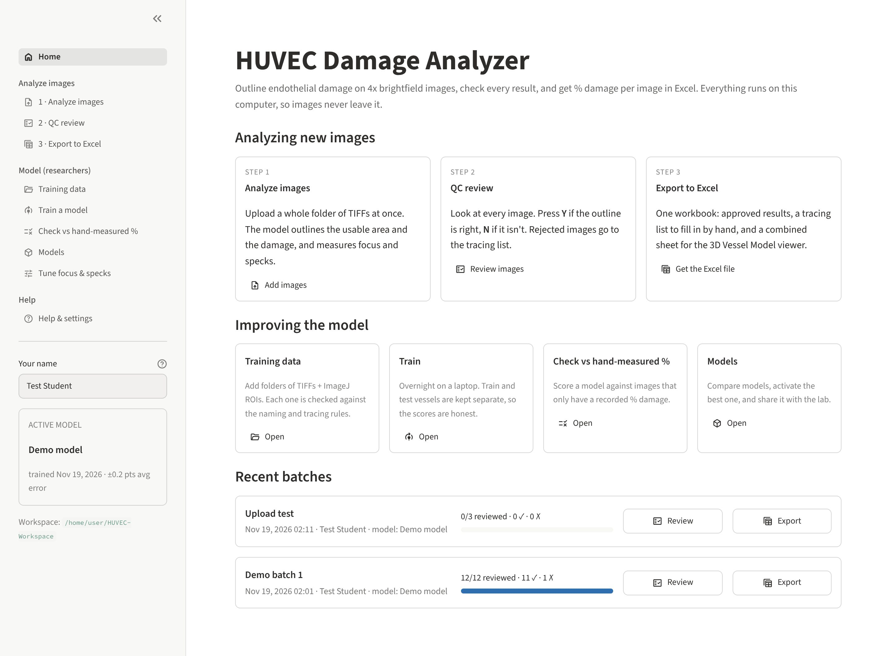
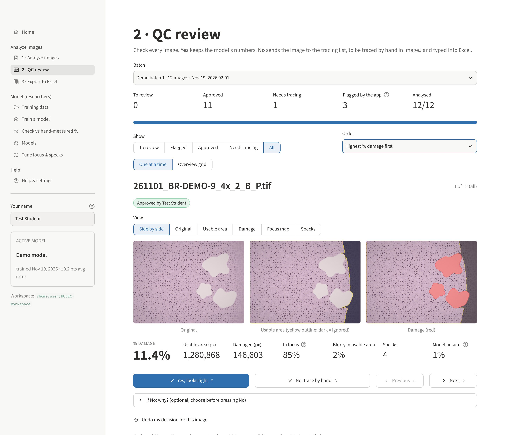

# HUVEC Damage Analyzer

Outlines endothelial damage on 4x brightfield images of HUVECs grown on silicone blood-vessel mimics. It reports **% damage per image**, and a person checks every result before it goes into Excel.

It replaces most of the manual ImageJ tracing:

1. **Analyze**: drop in a batch of TIFFs. A segmentation model marks the **usable area (TUA)** and the **damage** in each image. It also measures focus and looks for black specks.
2. **QC review**: a lab member looks at every image and presses **Y** (looks right) or **N** (trace it by hand).
3. **Export**: one Excel workbook. Approved images carry the model's numbers. Rejected images are listed with yellow cells to fill in after tracing by hand. A combined sheet updates by itself and loads straight into the [3D Vessel Model viewer](https://github.com/aidenedwards406/3D-vessel-model).

Researchers can add newly traced images and retrain the model from the same app. They can check every new model against hand-measured % damage before switching to it.



> **Everything runs on the lab computer.** The app opens in a web browser, but it is served from the computer itself (`localhost`). It is not reachable from other computers, it sends no usage statistics, and images are never uploaded anywhere. This repository holds only code: images, ROIs, results and trained models are blocked by `.gitignore`.

## Quick start (Windows)

1. Download this folder (green **Code** button → *Download ZIP*) and unzip it somewhere permanent, e.g. `Documents\HUVEC-Damage-Analyzer`.
2. Double-click **`install.bat`**. It downloads Python and the libraries (about 1 GB, 5–15 minutes) and needs no admin rights. It adds a **HUVEC Damage Analyzer** shortcut to the desktop.
3. Double-click the shortcut (or `start.bat`). The app opens in your browser.
4. On the **Models** page, import the lab's current model file (`.pth`, shared by your PI). To practise first, go to **Help & settings → Create demo data**.

macOS/Linux: `./install.sh`, then `./start.sh`.

| Guide | For |
|---|---|
| [docs/USER_GUIDE.md](docs/USER_GUIDE.md) | Everyone analyzing images: analyze → QC review → Excel → tracing |
| [docs/RESEARCHER_GUIDE.md](docs/RESEARCHER_GUIDE.md) | Adding training data, training, checking and sharing models, tuning the detectors |
| [docs/HOW_IT_WORKS.md](docs/HOW_IT_WORKS.md) | The methods (model, metrics, focus, specks) and the code layout, for whoever maintains this next |

## What each page does

| Page | |
|---|---|
| **1 · Analyze images** | Upload many TIFFs at once, or point to a folder. Analysis runs in the background, about 2–4 s per image on a laptop. Interrupted batches can be resumed. |
| **2 · QC review** | Original, usable-area and damage pictures side by side, plus focus and speck views. **Y / N / ← / →** keyboard shortcuts, optional reasons for "No", flags for blurry images, small usable area, model unsure, and specks. |
| **3 · Export to Excel** | The workbook described below, plus optional `<image>_trace.png` outlines for the 3D viewer. |
| **Training data** | Add folders of TIFF + ImageJ ROIs. Every image is checked against the naming and tracing rules, and you can preview the ROIs as masks. Mark control vessels. |
| **Train a model** | Leave-one-vessel-out cross-validation or your own train/validation/test vessels. Live progress, an ETA, and a time estimate for your computer. |
| **Check vs hand-measured %** | Run a model on images that only have a recorded % damage (the lab's ~500). Gives agreement statistics, a list of images worth tracing next, and threshold calibration. |
| **Models** | Every model's test report (Bland–Altman, Dice, per vessel). Activate one (with a warning if it does worse on shared benchmarks), share or import `.pth` files. |
| **Tune focus & specks** | Sliders with a live preview to fit the focus and speck detectors to real images. |



## The Excel workbook

| Sheet | Columns | Notes |
|---|---|---|
| **Approved** | Image name · Total usable area (px) · **% damage** | QC "yes". % damage has a heat map. |
| **Needs tracing** | Image name · Total usable area (px) · **% damage** | QC "no" (or the image couldn't be analysed). Yellow cells for the hand-traced numbers. Only 0–100 is accepted. |
| **All images** | Image name · Vessel · Treatment · Section · Side · Position · Result from · TUA (px) · **% damage** | Final numbers: the model's when approved, the hand-traced ones once typed in. Values are looked up by image name, so sorting other sheets is safe. The 3D Vessel Model viewer picks this sheet automatically. |
| **Per vessel** | Vessel · Treatment (type in) · Images · Images with a result · Mean % damage | Type each vessel's treatment once and it fills the Treatment column on All images. |
| **Details** | Thumbnails (original / usable area / damage), damage px, TUA px, % damage, focus, specks, flags, QC decision, reasons, reviewer | For auditing. |
| **About** | Model, settings, definitions, instructions | |

Numbers can only be changed in Excel, not in the app.

## Status

Version 1.0, tested here on synthetic look-alike images (it can't see the NDA images):

- **34 automated tests** cover the ROI→mask rules (including ImageJ's pixel-counting convention), file-name parsing, the focus/speck detectors, metrics, the Excel layout, single-split and cross-validation training, batch analysis, QC and benchmarks (`python -m pytest`).
- Every page was driven in a real browser (analyze → keyboard QC → export → benchmark). The workbook was recalculated in LibreOffice after a simulated student filled in the tracing sheet.
- **Not tested yet:** the Windows `install.bat`/`start.bat` on a real Windows laptop, real images, and training speed on a Surface Pro. See [What to do first with real data](docs/RESEARCHER_GUIDE.md#what-to-do-first-with-real-data).

## Repository layout

```
app.py                 Streamlit entry point (navigation)
ui/                    one file per page + shared widgets and charts
huvec/                 the library (usable from notebooks too)
  naming.py rois.py      file names, ROI matching, ROI -> 3-class masks
  focus.py specks.py     focus map, speck detection
  model.py data.py       U-Net (ResNet-18), augmentation, tiles
  train.py analyze.py    background jobs: training, batch analysis
  benchmark.py           hand-measured % benchmarks, calibration
  predict.py overlays.py numbers, flags and pictures for one image
  excel.py               the workbook
  registry.py library.py batches.py jobs.py workspace.py settings.py
  synthetic.py           look-alike demo data (safe to share)
tests/                 pytest suite
install.bat start.bat  Windows setup / launcher (install.sh / start.sh for macOS/Linux)
```
